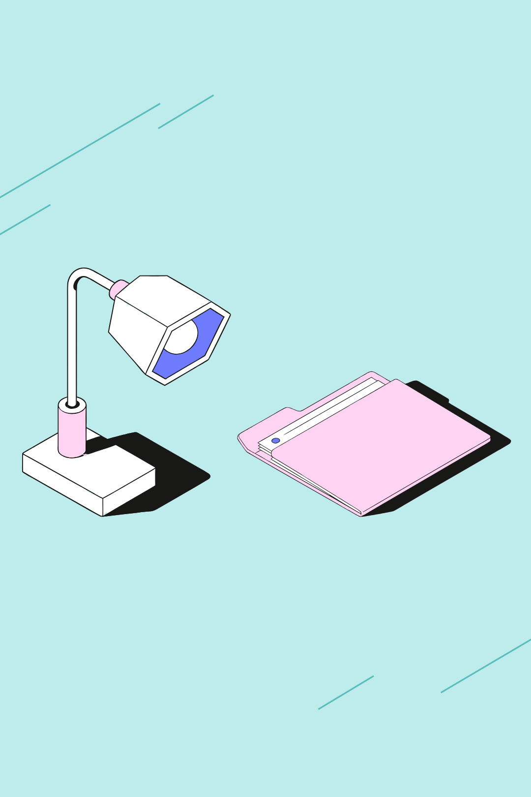

# Конструктор иллюстраций

Веб-сервис собирает иллюстрации только из готовых SVG библиотеки: 10 объектов, у каждого главная и фоновая версия, размеры S и L. Сцена перекрашивается по палитре и скачивается отдельным SVG.

## Запуск

Нужен pnpm.

```bash
pnpm install
pnpm dev
pnpm test
pnpm smoke:nvidia
```

`pnpm dev` открывает редактор и тот же `POST /api/compose`, что уйдёт на Vercel. `pnpm test` гоняет Vitest. `pnpm smoke:nvidia` делает один живой запрос и печатает id и модель, сам ключ не печатает. В CI его нет.

Ключ `NVIDIA_API_KEY` кладётся в `.env.local` (или в `.env`) локально и в Environment Variables проекта Vercel. Сервер читает сначала `process.env`, затем `.env.local`, затем `.env`. Префикс `VITE_` не используется: с ним Vite положил бы ключ в браузер. Образец — `.env.example`.

## Архитектура

Реестр `src/library/registry.ts` грузит 40 SVG объектов и 6 фонов схем. У каждого объекта id из манифеста (`book`, `phone`, `puzzle`, `coin`, `headphones`, `lamp`, `flowers`, `wallet`, `folder`, `pen`). Внутри файлов Figma повторяет `Vector` и `clip0_0_4`, поэтому id получают префикс: объект — `{objectId}-{size}-{role}-`, фон схемы — `bg-{scheme}-{size}-`, экземпляр на сцене — ещё и `{uid}-`.

Перекраска идёт по слотам, не по ближайшему цвету. Исходный hex lilac → слот (`bg.base`, `bg.mid`, `bg.dark`, `ink`, `obj.1`, `obj.2`, `obj.3`, `paper`) → цвет того же слота в выбранной схеме. Фоновые версии монохромные и берут только слоты фона. Белый `paper` в фонах разрешён.

Раскладка — шаблон (`under-title`, `offset`, `compact`). По умолчанию от двух объектов берётся компактный: группа держится у центра, масштаб один на всю сцену. На книгу, папку и кошелёк можно ставить телефон, пазл, ручку и монету по правилам опоры (на папку — пазл, ручка, монета; на кошелёк — монета). Наушники, лампа и ваза только рядом, не поверх. Кто ниже в кадре, тот ближе и выше по z. Фон не перекрывает главные объекты, в кадре видно не меньше 60% его bbox, центр фона остаётся внутри кадра.

`POST /api/compose` принимает `{ text, format }`. Цепочка NVIDIA: `nvidia/nemotron-3.5-lightning-30b-a3b` с `chat_template_kwargs.enable_thinking: false`, при ошибке, таймауте (~9 с) или 429 — `z-ai/glm-5.3-flash`, затем фолбэк по тегам. Без ключа сразу теги. Клиент ключ не отправляет.

«Скачать SVG» пишет файл размера кадра. У каждого объекта именованная группа `<g>`, id только ASCII (`^[A-Za-z0-9_-]+$`), кириллица остаётся в `data-name`. Корень — группа `composition`, обрезка — `clipPath` `frame-clip`. Нет `<use>`, `<image>` и `foreignObject`, цвета запечены в заливки. Файл импортируется в Figma как редактируемые слои.

## Допущения

«20 иллюстраций» в задании — это 10 объектов × 2 версии (главная и фоновая), а не 20 разных рисунков. Размеры кадров выбраны нами: горизонталь 1200×630, квадрат 1080×1080, вертикаль 1080×1620. Формат загрузки палитры тоже наш — JSON из восьми слотов или восемь hex по строке, — потому что формат Figma-плагина неизвестен.

## Инструменты

Редактор и сервер написаны в Cursor: cloud agents, ведущая модель grok-4.7 high, хелперы composer-2.5. Экспорт сверялся импортом в Figma через Figma MCP. В рантайме режима «Смысл» отвечают модели NVIDIA build API, перечисленные выше.

## Примеры

Три сцены собраны без ключа NVIDIA, фолбэком по тегам. Это честный результат `composeScene` без `apiKey`, не ответ модели.

| Запрос         | Формат    | Схема  | Объекты               |
| -------------- | --------- | ------ | --------------------- |
| учёба          | 1200×630  | Сирень | книга, ручка на книге |
| деньги         | 1080×1080 | Персик | монета на кошельке    |
| работа в офисе | 1080×1620 | Бирюза | лампа и папка рядом   |


[SVG](examples/ucheba-landscape-lilac.svg)


[SVG](examples/dengi-square-peach.svg)



[SVG](examples/office-portrait-teal.svg)

PNG — скриншот того же SVG в headless Chrome (Playwright). Повторить SVG: `EXPORT_EXAMPLES=1 pnpm exec vitest run scripts/export-examples.test.ts`.

## Демо

TODO: ссылка на деплой Vercel.

TODO: ссылка на видео.

## Деплой

`vercel.json` собирает Vite (`pnpm build` → `dist`) и объявляет `api/compose.ts` функцией с `maxDuration` 30 секунд: два таймаута по 9 секунд не укладываются в 10. На Hobby-плане платформа может срезать лимит до 10 секунд. Ключ задаётся только в окружении Vercel, в клиентский бандл он не попадает.
