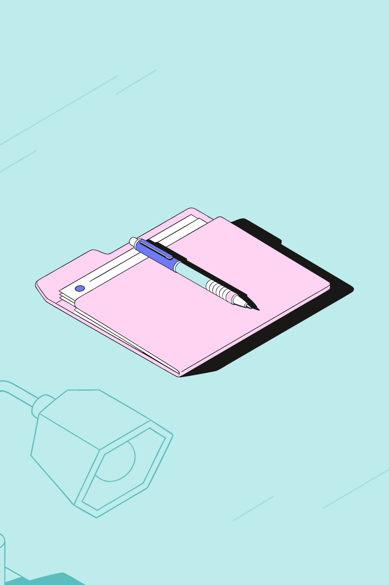

# Конструктор иллюстраций

Веб-сервис собирает иллюстрации только из готовых SVG библиотеки: 10 объектов, у
каждого главная и фоновая версия, размеры S и L. Сцена перекрашивается по
палитре и скачивается отдельным SVG.

## Демо

<https://ochen-svg-composer.vercel.app>

## Интерфейс

В блоке «Режим» две кнопки. С открытия выбран «Названия». «Собрать» и Enter
отправляют строку. Пока идёт ответ, на кнопке написано «Подбираем…», и она
отключена.

«Названия» делит строку по запятой, точке с запятой, «+» и союзу «и». Часть
сверяется с русским именем, английским и синонимами. У слова длиннее четырёх
букв снимается окончание. Слово короче четырёх букв должно совпасть точно, из
четырёх–шести букв может отличаться на одну, более длинное — на две.
Совпадение берётся, только если вышел один объект. Число перед именем задаёт
копии («2 книги»). Часть из нескольких слов, не узнанная целиком, проверяется
по словам. Узнанное раскладывается в текущем формате и размере. В чипах имя
и, если копий больше одной, « × N». Неузнанные слова идут строкой
«Не распознано: » и списком через запятую. Если совпадений нет, объекты на
холсте остаются. «Собрать» снимает подпись прошлой сборки «Смысла». Сборка
идёт на клиенте. Теги вроде «учёба» забирает режим «Смысл».

«Смысл» отправляет метафору `{ text, format }` на `POST /api/compose`. Сервер
подбирает объекты каскадом NVIDIA (раздел «Архитектура») по каталогу имён и
тегов. Нет ключа, каскад не ответил, запрос не дошёл или ответ не разобран —
сцена собирается по тегам. В чипах объекты сцены, у фонового к имени
добавляется « · фон». Под чипами источник: «Собрала модель», если ответила
модель, и «Собрано по тегам», если сцена собрана по тегам. Причина
дописывается через точку, когда начинается с «По смыслу». Пустая строка ничего
не меняет.

«Горизонталь», «Квадрат» и «Вертикаль» ставят кадр 1200×630, 1080×1080 и
1080×1620. Кнопки «Под заголовком», «Со смещением» и «Собранно», как и
«Собрать», ставят шаблон. С шаблоном новый формат раскладывает сцену
заново, ручной сдвиг не сохраняется. Без шаблона объекты переносятся
пропорционально новому кадру, масштаб следует короткой стороне.

«S» и «L» подставляют файл этого размера. С шаблоном сцена раскладывается
снова: герой занимает около 72% короткой стороны на S и около 82% на L. Без
шаблона места объектов те же, меняется масштаб.

«Сирень», «Персик» и «Бирюза» перекрашивают сцену в эту схему. Своя палитра
кнопкой «Загрузить» в блоке «Палитра JSON» добавляет в тот же ряд кнопку со
своим именем.

«Другие цвета» есть в «Свойствах» у выбранного главного объекта. Каждое
нажатие сдвигает слоты `obj.1`, `obj.2`, `obj.3` по кругу. `ink` и `paper` не
меняются. У фонового объекта кнопки нет.

В «Свойствах» без выбора написано «Объект не выбран». Иначе имя, ползунок
«Поворот» от -180° до 180°, кнопки «−15°», «+15°», «Дублировать», «Удалить»,
«Ниже» и «Выше». Роль переключают «Сделать фоновым» и «Сделать главным».
«−15°» и «+15°» прибавляют 15°, ползунок ставит угол сразу. «Ниже» и «Выше»
меняются местами с соседним слоем.

Объект на холсте перетаскивается: нажатие выбирает его, движение сдвигает.
Нажатие мимо объектов снимает выбор.

«Скачать SVG» пишет файл размера текущего кадра.

## Запуск

Нужен pnpm.

```bash
pnpm install
pnpm dev
pnpm test
pnpm lint
pnpm build
pnpm smoke:nvidia
```

`pnpm dev` открывает редактор и тот же `POST /api/compose`, что уйдёт на Vercel.
`pnpm test` гоняет Vitest. `pnpm lint` — ESLint и Prettier. `pnpm build`
проверяет типы, собирает клиент в `dist` и склеивает функцию `api/compose.js`.
`pnpm smoke:nvidia` делает один живой запрос и печатает id и модель, сам ключ не
печатает. В CI его нет.

Ключ `NVIDIA_API_KEY` кладётся в `.env.local` (или в `.env`) локально и в
Environment Variables проекта Vercel. Сервер читает сначала `process.env`, затем
`.env.local`, затем `.env`. Префикс `VITE_` не используется: с ним Vite положил
бы ключ в браузер. Образец — `.env.example`.

## Форматы

| Формат      | Кадр      | Где в редакторе |
| ----------- | --------- | --------------- |
| горизонталь | 1200×630  | landscape       |
| квадрат     | 1080×1080 | square          |
| вертикаль   | 1080×1620 | portrait        |

Размер S или L задаёт заливку героя и какой файл библиотеки берётся. Палитра —
одна из трёх схем (Сирень, Персик, Бирюза) или свой JSON.

## Архитектура

Реестр `src/library/registry.ts` грузит 40 SVG объектов и 6 фонов схем. У
каждого объекта id из манифеста (`book`, `phone`, `puzzle`, `coin`,
`headphones`, `lamp`, `flowers`, `wallet`, `folder`, `pen`). Внутри файлов Figma
повторяет `Vector` и `clip0_0_4`, поэтому `rewriteSvgIds` переписывает id,
`url(#id)` и `href`: объект — `{objectId}-{size}-{role}-`, фон схемы —
`bg-{scheme}-{size}-`, экземпляр на сцене — ещё и `{uid}-`. Следующий `obj-N`
выдаёт `nextUid`.

Перекраска идёт по слотам, не по ближайшему цвету. Исходный hex lilac → слот
(`bg.base`, `bg.mid`, `bg.dark`, `ink`, `obj.1`, `obj.2`, `obj.3`, `paper`) →
цвет того же слота в выбранной схеме. Фоновые версии монохромные и берут только
слоты фона. Белый `paper` в фонах разрешён.

Раскладка — шаблон (`under-title`, `offset`, `compact`). Сначала выбирается
герой, самый крупный главный объект, и масштабируется один раз на всю сцену. На
L его сторона занимает около 82% короткой стороны кадра (середина полосы
75–90%), на S — около 72% (середина 65–80%). Герой может выходить за край.
Второй план садится вплотную и кадр обрезает его примерно до половины бокса: в
квадрате и вертикали это один объект (всего два), в горизонтали — до двух. На
книгу, папку и кошелёк можно ставить телефон, пазл, ручку и монету по правилам
опоры (на папку — пазл, ручка, монета; на кошелёк — монета). Наушники, лампа и
ваза только рядом, не поверх. Если главных больше слотов, герой чуть уменьшается
внутри допустимой полосы, пока все названные главные остаются в кадре. Кто ниже
в кадре, тот ближе и выше по z. Фон не перекрывает главные объекты, в кадре
видно не меньше 60% его bbox, центр фона остаётся внутри кадра.

`POST /api/compose` принимает `{ text, format }`. Цепочка NVIDIA, по порядку:
`nvidia/nemotron-3-ultra-550b-a55b`, `nvidia/nemotron-3.5-lightning-30b-a3b`,
`z-ai/glm-5.3-flash`, `minimaxai/minimax-m3.1-flash`,
`stepfun-ai/step-5-preview`. Первые три запрашиваются сразу и параллельно:
берётся первый годный JSON, остальные отменяются. Если волна ничего не вернула,
идут следующие, пока не кончится дедлайн 10 с. Свой порядок — переменная
`NVIDIA_MODELS`, id через запятую. У каждой модели таймаут 4 с. Модель, которая
не успела, в этом процессе пропускается около 25 с; если в паузе все, всё равно
пробуется первая. Nemotron Lightning и GLM запрашиваются с выключенным thinking,
MiniMax — с `thinking_mode: disabled`, `reasoning_effort: none` и `max_tokens`
1600, иначе ответ уходит в `reasoning_content`, а `content` пустой. Из текста
снимаются теги `<think>`. Без ключа сразу теги. Ответ — JSON с полями `main`,
`background`, `template`, `reason` и `source`: `model` или `tags`. У ответа
модели есть ещё `model` — id той, которая ответила. Клиент ключ не отправляет.

На ширине до 640px холст стоит первым, под ним панель, строка запроса,
библиотека и инспектор. Блоки «Режим», «Масштаб» и «Палитра JSON» свёрнуты; на
широком экране они раскрыты. Кнопки панели листаются по горизонтали.

«Скачать SVG» пишет файл размера кадра. У каждого объекта именованная группа
`<g>`, id только ASCII (`^[A-Za-z0-9_-]+$`), кириллица остаётся в `data-name`.
Корень — группа `composition`, обрезка — `clipPath` `frame-clip`. Нет `<use>`,
`<image>` и `foreignObject`, цвета запечены в заливки. Файл импортируется в
Figma как редактируемые слои.

Состояние сцены — Zustand (`src/store`). Редьюсер композиции, разбор сохранённой
палитры, строка запроса и горячие клавиши разложены на небольшие функции. Клиент
и `api/compose.js` собираются раздельно: esbuild кладёт серверный обработчик в
один файл без импортов `.ts`.

## Допущения

«20 иллюстраций» в задании — это 10 объектов × 2 версии (главная и фоновая), а
не 20 разных рисунков. Размеры кадров выбраны нами: горизонталь 1200×630,
квадрат 1080×1080, вертикаль 1080×1620. Формат загрузки палитры тоже наш — JSON
из восьми слотов или восемь hex по строке, — потому что формат Figma-плагина
неизвестен.

## Инструменты

Редактор и сервер написаны в Cursor: cloud agents, ведущая модель grok-4.7,
хелперы composer-2.5. Экспорт сверялся импортом в Figma через Figma MCP. В
рантайме режима «Смысл» отвечают модели NVIDIA build API, перечисленные выше.

## Примеры

Три сцены собраны живым `POST /api/compose` (`source: "model"`, модель
`nvidia/nemotron-3.5-lightning-30b-a3b`). Размер L. Рисунок собирают
`composePick` и `exportSvg`.

### учёба

Запрос «учёба». Формат 1200×630, Сирень.
Объекты: книга, ручка на книге, лампа.


### деньги

Запрос «деньги». Формат 1080×1080, Персик.
Объекты: кошелёк крупно, монета на нём.


### работа с документами

Запрос «работа с документами». Формат 1080×1620, Бирюза.
Объекты: папка, ручка на папке, лампа.



PNG — растр того же SVG через resvg, в размер кадра. Повторить SVG и PNG:
`EXPORT_EXAMPLES=1 pnpm exec vitest run scripts/export-examples.test.ts`.

## Деплой

`vercel.json` собирает Vite (`pnpm build` → `dist`). `POST /api/compose` —
отдельная функция: `pnpm build` склеивает её esbuild в один `api/compose.js` без
импортов `.ts`, манифест библиотеки уже внутри файла. У функции `maxDuration` 30
секунд. Цепочка сама останавливается за 10 секунд, чтобы уложиться в срез
Hobby-плана. Ключ задаётся только в окружении Vercel, в клиентский бандл он не
попадает.

## Тесты

`pnpm test` покрывает подбор по именам и тегам, цепочку модели с фолбэком,
раскладку крупного плана, перекраску, экспорт SVG и редактор. `pnpm lint` и
`pnpm build` должны проходить вместе с тестами.
